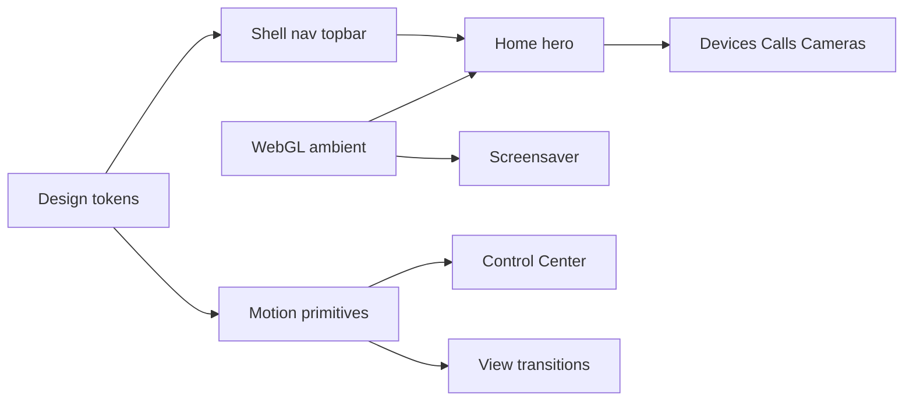

# Professional ambient UI upgrade

## Design direction (locked)

**Identity:** premium household appliance — closer to a calm wall panel than a SaaS dashboard or a marketing site with floating 3D gadgets.

**Keep:** mint accent, glass-lite dark base, vanilla ES modules + single [`src/styles.css`](src/styles.css), existing `h()` / reconcile model.

**Change:** hierarchy, type, motion language, ambient depth, empty-state illustration, and Home information architecture.

**WebGL choice:** one small shared ambient module (Three.js r170+ or a ~80-line WebGL2 shader plane — pick Three.js for maintainability) used **only** on Home hero + screensaver + optional Light Studio preview. No 3D on Devices/Settings lists. Honor `prefers-reduced-motion` by swapping to static CSS gradients.

## Phase 1 — Design system foundation

File: [`src/styles.css`](src/styles.css) (+ light theme remap)

- Expand tokens: type scale (`--fs-xs` … `--fs-display`), spacing (`--space-1` … `--space-8`), elevation (`--elev-1/2/3`), motion (`--ease-out`, `--dur-fast/med/slow`).
- Replace default system/`Inter` stack with a deliberate pairing already available on Mac + web fonts optional: **SF Pro Display** for hub clock / titles, **SF Pro Text** for UI (fallback: `ui-rounded` / system). Avoid generic AI-slop purple/cream looks; keep mint-on-graphite.
- Nav: clearer active state (left accent rail + filled surface), slightly taller touch targets for wall use.
- Topbar: hide duplicate clock while on Home (hero owns time); keep clock on other routes.
- Global view enter: short opacity + 6–8px translate using token durations; respect reduced motion.
- Delete or wire orphan `.dash` rules to stop drift.

## Phase 2 — Home as the brand moment

Files: [`src/js/views/dashboard.js`](src/js/views/dashboard.js), new [`src/js/ambient.js`](src/js/ambient.js), [`src/styles.css`](src/styles.css)

- **Hero composition (first viewport):** one composition — large time, one weather line, presence chip, Now Playing strip. Move KPI / board / device panels below the fold.
- **Ambient layer:** full-bleed WebGL behind hero (soft volumetric wash reacting to `data-period` dawn/day/dusk/night and optional now-playing energy). Pause when tab hidden; destroy on leave Home.
- Finish empty `.home.ambient` kiosk rules: soften plan/rooms until interaction; enlarge clock; Control Center as primary actions.
- Sticky “Rooms” section title + edge-faded room tabs.
- Empty / offline states: simple SVG illustrations (house silhouette, no-camera, no-peer) in a tiny [`src/js/illustrations.js`](src/js/illustrations.js) — same stroke language as icons in [`src/js/dom.js`](src/js/dom.js).

## Phase 3 — Motion & overlays

Files: [`src/js/controlcenter.js`](src/js/controlcenter.js), [`src/js/notify.js`](src/js/notify.js), [`src/js/screensaver.js`](src/js/screensaver.js), CSS

- Control Center: sheet slides up (`translateY`) with scrim fade; Escape + focus first control; `aria-modal`.
- Wall ring / banners: single notification system (no double toast+banner); safe-area insets.
- Screensaver: reuse ambient WebGL at lower FPS instead of only CSS orbs; keep tap-to-wake.
- Device tiles / toggles: 150–200ms springy press (`scale` + glow), not bounce spam.

## Phase 4 — Cascade polish (same system, no new aesthetic)

- **Calls** ([`src/js/views/call.js`](src/js/views/call.js)): ≥900px two-column — stage left, peers/contacts right; wider page; fix mute icon semantics.
- **Devices:** toolbar priority (search + Add primary; Scan/Remove in overflow); remove competing Add vs topbar duplication on that route.
- **Cameras:** live/offline badge, skeleton while frame loads, scrim when offline.
- **Light Studio:** optional ambient shader preview tied to effect hue (same `ambient.js` API).

## Explicit non-goals

- No React/Vue rewrite.
- No Three.js on every scroll list.
- No purple-gradient / glassmorphism-for-its-own-sake rebrand.
- No embedding FaceTime/WhatsApp video (platform-impossible); Calls stay Home Call + polished in-app stage.

## Implementation order for the executor

1. Tokens + shell (nav/topbar/clock)  
2. `ambient.js` + Home hero restructure  
3. Control Center / screensaver / illustrations  
4. Call / Devices / Cameras cascade  

Ship after Phase 2 is visibly “premium”; Phases 3–4 are polish on the same system.
